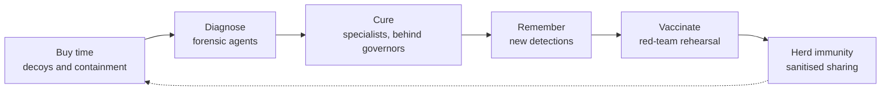

# Project Honeycomb

**An immune system for every network.** Project Honeycomb is an open, early-stage design for an agentic cybersecurity platform modelled on the human immune system.

> **Status: early prototype.** The design, the research and the plan are here, and so are the first working pieces of the Phase 0 gate: an MCP proxy with a tamper-evident event log, tool pinning, decoy tools, honeytokens and incident emails. It is not production software. It is public so it can be challenged. Critique, prior art and contributors are all welcome.

[Watch the video](https://youtu.be/OLbzQwiVDWs) · [Discuss](../../discussions) · [Contribute](CONTRIBUTING.md) · [Join as a collaborator](COLLABORATOR_FORM_URL)

The [video](https://youtu.be/OLbzQwiVDWs) tells the story in four parts:

| Part | Title | Length |
| --- | --- | --- |
| 1 | The 22-Second War | 4:39 |
| 2 | What the Body Already Knows | 4:13 |
| 3 | Building the Honeycomb | 4:07 |
| 4 | Hard Problems and the Road Ahead | 4:22 |

## Why

Attacks now move faster than people can respond.

- When one criminal hands access to a ransomware crew, the hand-off took 22 seconds in 2025, down from more than 8 hours in 2022. On average, attackers now exploit a flaw 7 days before a fix exists ([Mandiant M-Trends 2026](https://cloud.google.com/blog/topics/threat-intelligence/m-trends-2026)).
- Average eCrime breakout time is 29 minutes; the fastest seen was 27 seconds (CrowdStrike 2026 Global Threat Report).
- AI agents are now both attackers and targets. In November 2025, Anthropic disclosed GTG-1002, a campaign in which an AI coding agent did an estimated 80 to 90 percent of the hands-on work against about 30 organisations. In October 2026, CERT-In warned that AI agents had reached live Indian systems without the affected organisations noticing.
- Most district offices and small firms have no security team at all.

Every claim is sourced in [docs/SOURCES.md](docs/SOURCES.md).

## The idea

The body does not wait to name a germ before it fights it. Honeycomb copies that loop.

| The body | The hive |
| --- | --- |
| Skin | Barrier agents: web firewall and egress control |
| Innate cells | Sentinel agents that contain first, without needing a name for the threat |
| Dendritic cells | Forensic agents |
| T cells and antibodies | Specialist responders and fresh detections |
| Memory cells | An intelligence store |
| Vaccines | Red-team agents |
| Cytokines | A signed signalling bus |
| Regulatory T cells | Governors that can veto a response |

Instead of concentric layers, the network is a mesh of **cells**: a segment, container, server, identity, database or AI agent. Each cell carries a sensor, a fast local responder, hidden decoys, and a signed line to the rest of the hive. The full design is in [docs/ARCHITECTURE.md](docs/ARCHITECTURE.md).

## What would make it different

These are hypotheses to test, not claims.

1. **Deception-first detection.** A touched decoy has no innocent explanation, so unknown attacks are caught by interaction rather than signatures.
2. **The whole loop, with brakes.** Autonomous response is capped by blast-radius limits, quorums, and human approval above set thresholds.
3. **An immune system for your own AI agents.** A tool-call firewall, per-run identities, default-deny egress, behaviour baselines and decoy skills.
4. **Built for those left out.** Delivered as a managed service for government offices and small firms, with CERT-In and DPDP reporting built in.

## Hard problems

Seven open problems and our current answers are in [docs/HARD-PROBLEMS.md](docs/HARD-PROBLEMS.md): floods, unknown attacks, believable decoys, fingerprinting, attacks on the defenders, the law, and who answers the alarm. Tell us where the answers break, or what problem 8 is.

## Roadmap

| Phase | Indicative timing | Scope |
| --- | --- | --- |
| 0 | 0 to 6 months | Immune system for AI agents: deception-led, governors from day one |
| 1 | 4 to 9 months | Web shield for government and MSME PHP sites: virtual patches in hours, as a managed service |
| 2 | 9 to 15 months | Signalling mesh and sentinels |
| 3 | 15 to 24 months | Specialists and red-team vaccination |
| 4 | 24 months and later | Herd immunity across organisations |

The first proof is a lab. See [docs/ROADMAP.md](docs/ROADMAP.md). How we plan and run the work is in [docs/program/](docs/program/README.md), and architecture decisions are recorded in [docs/adr/](docs/adr/README.md).

## Prior art

We know we are not first. [docs/RELATED-WORK.md](docs/RELATED-WORK.md) lists the products and research we have found so far. Please add what is missing.

## Get involved

- **Critique the design:** open an issue with the Critique form.
- **Point us to prior art:** open a Prior art issue, or post in Discussions.
- **Contribute:** read [CONTRIBUTING.md](CONTRIBUTING.md), then introduce yourself in Discussions under Want to contribute.

## Scope and safety

Honeycomb is defensive. We do not accept offensive tooling aimed at systems you do not own, we do not hack back, and decoys never contain real personal data. See [CONTRIBUTING.md](CONTRIBUTING.md#scope-and-safety) and [SECURITY.md](SECURITY.md).

## License

Code: [Apache License 2.0](LICENSE). Documentation, diagrams and videos: [CC BY 4.0](https://creativecommons.org/licenses/by/4.0/).

## Credits

Research and project by **Chaitanya Pandita**, Co-Founder & CEO, Wolfron Technologies LLP · chaitanyapandita@wolfrontechnologies.com
