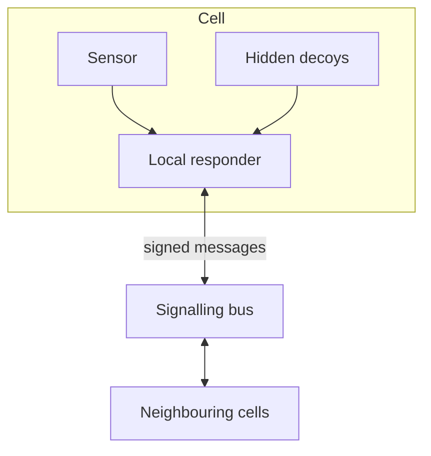

# Architecture

Status: proposed design. Everything here is open to change.

## Principles

- **Contain first, name later.** Slow and isolate a suspicious session before knowing exactly what it is.
- **Deception first.** Decoys turn "is this normal?" into "why would anyone touch this?".
- **Autonomy with brakes.** Agents act at machine speed, inside limits that people set.
- **Trust nothing by default.** Not traffic, not text, not other agents.
- **Learn once, protect everyone.** Every attack becomes a detection, a rehearsal and, once sanitised, shared protection.

## Cells

A cell is the smallest thing you can watch and isolate on its own: a network segment, a container, a server, an identity, a database or an AI agent. Every cell carries four things.

| Part | Job |
| --- | --- |
| Sensor | Watches the cell's behaviour |
| Local responder | Contains first: slows, isolates, blocks |
| Hidden decoys | Fake data, credentials and services no legitimate user needs |
| Secure line | Signed connection to the signalling bus |

## Agent roles

| Agent | Body equivalent | Job |
| --- | --- | --- |
| Barrier | Skin | Patch and shield the edge; web firewall and egress control |
| Sentinel | Innate cells | Watch every cell and contain first |
| Deception | (none) | Plant and tend decoys |
| Forensic | Dendritic cells | Reconstruct the attack: commands, tools, addresses |
| Coordinator | Lymph node | Decide which response runs |
| Specialist | T cells | Plan the cure for a known class of attack |
| Remediation | Antibodies | Apply the cure and write new detections |
| Governor | Regulatory T cells | Hold the brakes; can veto any response |
| Memory | Memory cells | Store what was learned |
| Red-team | Vaccines | Rehearse tomorrow's attack today, across every cell |

## Signalling bus

Cells talk over a bus, the hive's version of cytokines. When one cell sees danger, its neighbours raise their guard before the attacker arrives.

The bus is also a target: a hijacked cell could cry wolf and trigger a storm. So every message is signed, agents trust nothing by default, and a cell sending improbable alarms is quarantined itself.

## Governors

- Cap the blast radius of any single action.
- Require a quorum (for example two of three governors) before anything high-impact.
- Pull in a human above a set threshold.
- Locking out an executive or rotating keys in the middle of payroll is never one agent's decision.

## Worked example

1. An attacker with a stolen password touches a decoy database. No legitimate user has a reason to be there, so the alarm is almost certainly real.
2. Sentinels slow the session and wall off the cell.
3. The decoy keeps answering with convincing synthetic records, buying time.
4. Forensic agents capture every command, tool and address, and brief the coordinator.
5. Specialists plan the cure: revoke the credential, isolate the host, push a virtual patch. High-impact steps need a quorum, and a human above the threshold.
6. The attack becomes new detections; red-team agents rehearse it across every cell.
7. A sanitised version of the lesson can protect other organisations: herd immunity.

## Phase 0 module: an immune system for AI agents

| Control | What it does |
| --- | --- |
| Tool-call firewall | Every tool call passes a policy check; tool descriptions are treated as untrusted input |
| Per-run identity | Each agent run gets a short-lived identity with least privilege |
| Default-deny egress | Outbound traffic is blocked at the network, not by a prompt |
| Behaviour baselines | Detect goal drift, tool misuse, poisoned memory, and agents adopting each other's goals |
| Decoy skills | Fake tools and credentials that only a hijacked agent would touch; touching one pauses the run and quarantines its identity |

Mapping these controls to the OWASP Top 10 for Agentic Applications (ASI01 to ASI10) is an open task.

## Open questions

- What is the minimum telemetry a cell needs to be useful?
- How should governors be configured for an organisation with no security staff?
- How do we keep the signalling bus fast while signing every message?
