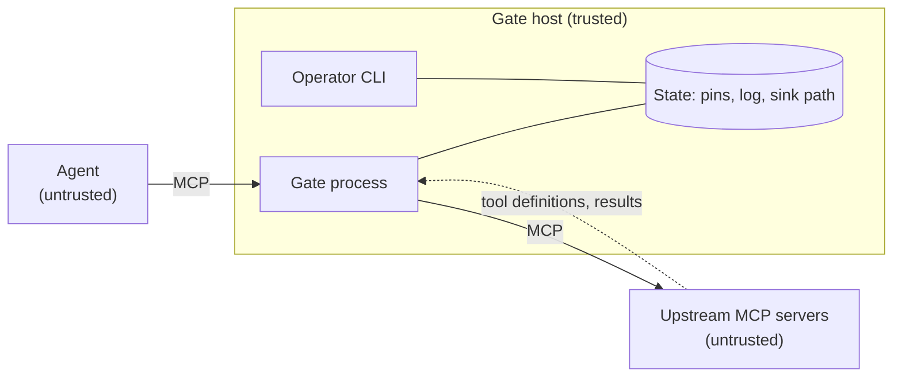

# Threat model: honeycomb-gate (M1)

Status: first version, 24 October 2026, covering what exists after M1 (event log, pinning, policy). We update it at every milestone. **A community developer should review it before gate G1**; findings go in section 8. Method: list assets and trust boundaries, then walk each component asking what an attacker could do, what stops them, how we test it and what remains.

## 1. Scope

In scope: the gate process, its config and state files (`pins.json`, the event log, the second sink), its CLI, and the link between agent, gate and upstream servers.

Out of scope for M1: the host operating system, the agent's own model, network enforcement (M3), decoys and honeytokens (M2), run tokens (M3), approvals (M4). Where a control belongs to a later milestone, the table says so, so nobody assumes it already exists.

## 2. Assets

| Asset | Why it matters |
| --- | --- |
| Data and actions reachable through upstream tools | What a hijacked agent would steal or damage |
| Pinned tool definitions (`pins.json`) | Decide which tool definitions the gate trusts |
| Policy file | Decides allow and deny |
| Event log and second sink | Evidence; the basis of incidents |
| Operator approvals | Turn a quarantined tool back on |

## 3. Trust boundaries

The agent, the upstream servers and everything they send (descriptions, results, errors) are untrusted. The gate host, the operator and the policy file are trusted. Without network enforcement (M3), nothing stops the agent bypassing the gate. The product treats that as enforcement level L0 or L1 ([ADR-0004](adr/0004-enforcement-levels.md)).

## 4. Adversaries

1. A malicious or compromised upstream MCP server (poisoned descriptions, rug pulls, shadowing, hostile results).
2. Indirect prompt injection steering the agent through documents, pages or tool output.
3. A compromised or runaway agent.
4. A local attacker or insider with some access to the gate host.
5. An attacker attacking the gate itself: flooding, malformed input, log tampering.

## 5. Threats and controls

Status: **Done** (built and tested in M1), **Later** (planned milestone), **Accepted** (residual risk we are choosing to carry).

| # | Threat | Control | Status | Test | Residual risk |
| --- | --- | --- | --- | --- | --- |
| T1 | Upstream changes a tool definition after trust is established (rug pull) | Per-tool SHA-256 over everything the agent sees (name, title, description, input and output schemas, annotations, execution hints); any change quarantines the tool; the operator must approve the exact pending hash after viewing a diff (`tools show`, `tools approve --hash`). A definition swapped right after an approval is quarantined too | Done | `test_scenario_s2`, `test_registry` | The default re-checks the live definition on every call (`recheck_ttl_s: 0`), at the cost of one extra upstream round trip. Raising it creates a window in which a changed tool is still trusted; a demo with a 2 s window let a poisoned tool through, which is why 0 is the default |
| T2 | Poisoned description from first sight (trust on first use) | Instruction-like text anywhere in a definition (description, title, schema fields) is flagged as `tool.suspicious_description`; strict mode requires approval before a tool is visible | Done (flags are signals) | `test_registry` malicious and benign sets | Learning mode pins a poisoned first definition; use strict mode for untrusted upstreams. Heuristics can be evaded |
| T3 | Tool-name shadowing or ambiguous routing across upstreams | Names are namespaced `upstream__tool`; upstream names are limited to lower-case letters, digits and `-`, so routing is unambiguous; pins are per upstream | Done | `test_ambiguous_upstream_names_are_rejected` | None known |
| T4 | Misleading tool annotations ("read only") or hidden metadata | Annotations are never used for any decision (but are pinned, so a change quarantines); `_meta` and icons are not forwarded to the agent | Done | `test_forwarded_tools_carry_no_unpinned_metadata`, `test_hash_covers_everything_the_agent_sees` | None known |
| T5 | Call to an unknown, hidden or quarantined tool by guessing its name | Resolved against live definitions; quarantined or unapproved tools are denied; policy hides denied tools from the list | Done | `test_passthrough`, `test_scenario_s2`, `test_a_definition_swapped_right_after_approval_is_still_caught` | None known |
| T6 | Over-broad or dangerous call (e.g. `exec`, 500 recipients) | First-match policy with tool, upstream and argument matchers. A deny rule treats a missing or wrong-typed argument as a match, so changing an argument's type does not slip past a limit; a rule that errors at runtime fails closed if it is a deny rule; high-impact patterns (`*exec*`, `*shell*`, `*delete*`, `*drop*`, `*truncate*`, `*destroy*`, `*wipe*`, case-insensitive) fail closed on error; `approve` and caps refuse to load until M4 | Done (allow, deny) / Later (approve, caps) | `test_policy` | Until M4 there is no human approval path |
| T7 | Policy typo silently weakens protection | Unknown fields rejected; unsupported features and invalid regular expressions refuse to load; argument matchers must name a tool or upstream; `policy check` command | Done | `test_policy` | A logically wrong rule still loads |
| T8 | Secrets written into logs | Key-based redaction (camelCase, snake_case and compound names such as `accessToken`, `api_key`) and value-based redaction before storage; agent-chosen names (`tool`, `upstream`) are redacted, stripped of control characters and shortened; strings are capped before scanning; digest of the full payload kept | Done | `test_events` (redaction, names), `test_passthrough` | New secret formats can slip through; redaction is best effort. State files are readable only by their owner, and the SQLite index is a convenience copy, not evidence |
| T9 | Attacker edits, deletes or reorders log lines | SHA-256 hash chain; `events verify` | Done | `test_events` | The hash is unkeyed: an attacker who can rewrite the log **and** the second sink can recompute everything (see T10). Backlog E1-6: keyed chain with the key held elsewhere, and a remote sink |
| T10 | Attacker truncates, deletes or replaces the log or the sink | A checkpoint (count and chain head) goes to the second sink after **every** event, plus full copies of high and critical events; the sink file is created at start, so a missing sink or a missing log fails `events verify`; one writer per log (a second gate is refused rather than forking the chain); a torn last line stops the gate instead of continuing a broken chain | Done if the sink is on storage the attacker cannot write | `test_events` | Same-account attackers can still rewrite both files. Later: remote sink |
| T11 | Attacker with write access to `pins.json` re-approves a poisoned tool or forges the recorded approver | Not prevented: state files are trusted (they are created readable only by their owner, and access is serialised with a file lock) | Accepted | n/a | Protect the state directory. Later: sign approvals; take approver identity from the approval broker |
| T12 | Approver identity is only the OS user name | Recorded in `tool.approved` | Accepted | n/a | Weak attribution. Later: approver identity from the approval broker (M4) |
| T13 | Log flooding or oversized input exhausts disk, memory or CPU | Lines capped at 8 KiB (tool and upstream names shortened to 128 characters, strings to 8 KiB before any scan); redaction patterns are bounded and tested for stalling; pagination capped at 100 pages with repeated cursors refused | Partial | `test_events`, `test_gate_robustness` | No rate limit on call volume yet; add in M4 with deduplication |
| T14 | Hostile tool results carry injections or planted secrets | Results are scanned for registered honeytokens (value or embedded id) and withheld on a hit; text classification is deliberately not used for decisions ([ADR-0003](adr/0003-data-plane-control-plane-split.md)) | Done for honeytokens | `test_honeytokens_in_gate`, `test_common_evasions_do_not_hide_a_token` | Injected instructions in results are not detected; the decoy catches the action they cause. Matching ignores case and invisible characters, sees through base64 and values split across fields or list items, and covers the tool name too. Not matched: other encodings (rot13, hex, home-made ciphers) and a token reassembled by the attacker's own code. Calls over 4 million characters are refused so nothing can be hidden past a scan limit |
| T15 | Agent bypasses the gate | Not enforceable by software alone | Later (M3) | n/a | Enforcement levels make this explicit; lab uses an internal network |
| T16 | Stolen or replayed identity | No run tokens yet; one run id per connection | Later (M3) | n/a | See ADR-0002 |
| T17 | Hijacked agent touches a decoy or honeytoken | Decoy tools in `tools/list` and honeytokens in the workspace. A trip pauses the run and opens an incident, automatically. "Revoking the identity" currently means the run id is retired and every call from it is refused; signed run tokens that other systems can check arrive in M3. A call already in flight when another call trips is not forwarded, and further trips are logged as evidence without opening more incidents. The pause survives a gate restart: a restarted gate starts paused until `runs resume` | Done | `test_scenario_s1`, `test_honeytokens_in_gate` | An agent that never touches a decoy or token is not caught by this control |
| T18 | A denied call leaks policy details to the attacker | Agent sees one generic message; reason is only in the log | Done | `test_passthrough` | The tool list itself reveals what exists |
| T21 | The audit record is lost after the action happened | The decision is logged **before** the call is forwarded; if the log cannot be written, the call does not happen. A second event, `call.completed`, records the outcome | Done | `test_a_call_is_not_forwarded_if_the_decision_cannot_be_logged` | A crash between the two events leaves a decision with no outcome, which is visible |
| T22 | An operator approves a definition they did not review | Approval requires the pending hash and fails if the definition changed since it was shown | Done | `test_approval_needs_the_hash_the_operator_reviewed` | The operator must still read the diff |
| T23 | Decoys are recognisable (names, descriptions, timing, data shape) | Per deployment: names drawn from a vocabulary, one of three wordings, row count, id range, phone prefix, a reserved example domain and the tarpit delay all differ; responses are seeded by the call (same question, same answer); no model in the response path | Partial | `test_decoys` | The built-in vocabulary and wording variants are public, so an attacker who knows the project can recognise the defaults; operators should add their own names and descriptions. An identical repeated call gets an identical answer on purpose |
| T24 | Honeytoken values leak into logs, incidents, emails or errors | Values are masked (ignoring case) in arguments, tool names and everything logged; incidents carry the token id only; text chosen by the agent is cleaned and shortened before it goes into an incident, so it cannot add fake sections to an email; the agent sees a generic block message | Done for exact values | `test_honeytokens_in_gate`, `test_tokens`, `test_gate_robustness` | A token the agent re-encodes before logging could appear encoded in `args_redacted` (it is a fake, but the claim "never logged" is only for the exact value). Token values sit in plaintext in `tokens.json` (readable only by the owner); someone who can read it learns which credentials are fake |
| T25 | Mail credentials leak or a mail outage weakens containment | Credentials come from the environment, are not passed to upstream servers (`upstreams.<name>.env` is the only environment they get), never appear in errors or logs; sending runs after the run is paused, off the hot path | Done | `test_a_mail_outage_does_not_weaken_containment_or_leak_secrets`, `test_notify` | The environment of the gate process holds the password, so anyone who can read that process's environment can read it |
| T26 | A tripped run is resumed by the attacker, or the pause is shaken off | Resume is a CLI action by an operator who can write the state directory; it retires the old run id and issues a new one. A restart does not clear the pause | Accepted | `test_resume_issues_a_new_identity_and_keeps_the_old_one_revoked` | Anyone who can write `runs.json` can resume a run (same trust as T11) |
| T27 | A hostile upstream exposes a tool with a decoy's name to make a legitimate call trip | A decoy whose name a real tool also uses is left out of the listing, logged as `decoy.collision`, and calls to that name go to the real tool | Done | `test_a_real_tool_named_like_a_decoy_is_not_treated_as_one` | None known |
| T28 | The mail send fails, hangs or is lost at shutdown | Sending runs in the background after the run is paused; failures are logged as `notify.failed` and kept on the incident; pending sends are awaited at shutdown (up to 15 s); the incident file is the source of truth and an acknowledgement is never overwritten | Done | `test_notify`, `test_scenario_s1` | A gate killed hard (power loss) can lose an unsent email; `incidents list` still shows the incident |
| T29 | MCP resources and prompts carry injected text, or are used to get around the gate | They go through the gate under `hc://<upstream>/...` and `upstream__name`. Requests and results are logged, size-capped and scanned for honeytokens (a hit withholds the result and trips the run), and a paused run gets nothing. Run scopes cover them | Done | `test_resources_and_prompts`, `test_front_door` | Injected text in a resource is logged, not judged: the gate can't tell a poisoned document from a real one. Policy deny rules, strict mode and pinning apply to tools only, not to resources and prompts, so a resource template that reaches the same data as a denied tool is not stopped by that rule (scopes are the only limit, per upstream). Any URI the upstream accepts can be read, not only listed ones. Resource templates, subscriptions and completions are not passed through |
| T30 | State files are deleted or edited to undo a protection (a pin file, the log, the sink, a pause record) | At start-up the gate checks the whole log chain against the second sink and refuses to start if anything is missing or changed. It also refuses if the log shows tools were pinned but `pins.json` is gone. A paused run is also worked out from the log, so deleting `runs.json` doesn't unpause it. Every refusal names the file and says what to do | Done | `test_startup_and_state`, `test_deleting_runs_json_does_not_unpause_after_a_restart` | Without a second sink, cutting the tail off the log, or deleting it, can't be told apart from a fresh install or a shorter history, so the sink matters. The full-chain check at start-up reads the whole log, which will need a smarter approach once logs get big |
| T31 | A honeytoken or injected text is hidden by nesting it deeply, or the scanner is crashed by deep nesting | The scanner walks payloads without recursion, so it has no depth limit and works on results too. Call arguments nested deeper than 100 levels are refused | Done | `test_a_token_is_found_however_deep_it_is_nested`, `test_absurdly_deep_arguments_are_refused_not_scanned` | None known |
| T32 | A deny regex is dodged by padding the value | A value longer than the regex input cap can't be judged, and deny rules treat that as a match | Done | `test_padding_cannot_hide_a_value_from_a_deny_regex` | Very long legitimate values are denied by such a rule |
| T33 | A huge upstream result or a slow scan stalls the gate for everyone | Results over 8 million characters are refused (and so never reach the agent, but the honeytoken scan doesn't run on them); the size check and the token scan run off the event loop; each upstream call has a timeout (`call_timeout_s`, default 120 s) | Done | `test_a_huge_result_is_refused_instead_of_stalling_the_gate`, `test_a_hung_upstream_call_times_out` | A hung upstream process isn't killed when the gate exits and can be left running. Not fixed yet |
| T34 | One broken upstream or damaged state file takes the whole gate down, or fails open | An upstream that dies after start-up is hidden and logged as `gate.error` while the others keep working (one that is dead at start-up stops the gate). Listing and calls both time out. Every state file is read at start-up, and a damaged one stops the gate with one message naming it. A full disk can't undo a trip: the run is paused in memory first, and a failed log write is cut back so it leaves no half line | Done | `test_gate_robustness`, `test_startup_and_state` | If the disk is full when a trip happens, the evidence lines are lost (the pause, the incident and the alert are still attempted separately) |
| T35 | The HTTP front door is reached by someone without a token, or with a stolen, forged, expired or revoked one | Every request is checked: signature (constant-time), key id, expiry, and that the run is still active in the registry. A trip or `identity revoke` closes the door for that run on the next request. Tokens live 15 minutes at most | Done | `test_identity`, `test_front_door` | A token stolen within its lifetime works until it expires or an operator revokes it, from anywhere that can reach the port. There is no binding to a client address |
| T36 | The signing key leaks or is guessed | The key is 32 random bytes in a 0600 file in the state folder, or an environment variable of at least 32 characters. Keys rotate, and old ones are dropped once no token can use them | Done | `test_identity` | Anyone who can read the state folder can mint tokens. The state folder must be private to the operator and the gate. Setting `HONEYCOMB_RUN_KEY` does not retire keys in the file: after a leak, delete the key file or rotate and wait out the token lifetime |
| T37 | The listener is attacked: oversized bodies, a hostile Host header (DNS rebinding), plain-text sniffing | It binds to 127.0.0.1 by default, rejects Host headers that aren't listed, and caps the request body. The gate does no TLS itself, and says so on start-up when bound elsewhere | Partly | `test_front_door` | Anything beyond the machine needs a private network or a reverse proxy that terminates TLS. Slow-connection floods are left to that proxy |
| T38 | A flood of bad requests fills the log or hides real events | Rejections are logged at most once per ten seconds, with a count of the ones skipped | Done | `test_front_door` | The skipped ones are counted, not individually recorded |
| T39 | An agent uses a registered agent's name to get its scopes, or an unregistered agent slips in | Scopes are fixed in the signed token at issue time, and only the operator issues tokens. Strict mode turns away unregistered agents at the door; learning mode accepts them with full scope and logs `agent.unknown` | Done | `test_front_door` | In learning mode an unknown agent gets full scope, by design. Scopes are fixed when a token is issued and copied on renewal, so narrowing an agent's scopes does not reach a live run: revoke it and issue a new token |
| T40 | The posture report claims more protection than exists | It separates declared from verified, never goes above L2 in Phase 0, and ignores a proof file when the operator hasn't declared network enforcement | Done | `test_posture` | The proof file is written by the lab test; nothing stops an operator writing it by hand |
| T41 | Tokens, resource addresses or tool arguments are hidden with percent-escapes | The scan also looks at the text with escapes undone, up to four layers deep, along with base64 and split values | Done | `test_honeytokens_in_gate` | Other encodings (hex, rot13) are not matched |
| T42 | A call still running when its run trips returns real data afterwards | The result is withheld if the run was paused while the call ran (a honeytoken in it is still recorded as evidence first) | Done | `test_gate_robustness` | The upstream has already done what the call asked; only the answer is held back |
| T43 | One run wedges a shared upstream, or a huge `identities.json` slows every request | Calls time out after `call_timeout_s`. The identity registry is read on every request | Accepted for M3 | none | A hung upstream stays hung for every run until the gate restarts. Old identities are never pruned, so the file grows; at 100,000 entries a request costs about half a second. Pruning and an in-memory index come in M4 |
| T44 | The agent sends data out without going through the gate | The lab puts the agent on an internal Docker network with no route out. Its only exits are the gate and the egress proxy, and the lab test proves direct connections fail before posture reports the network as verified | Done in the lab | `uv run python -m lab.run_lab` (S3) | Only as strong as the network setup. Off Docker, the operator must build the same isolation, and posture can only report it as declared |
| T45 | A honeytoken or data leaves through the proxy | Plain HTTP requests to any host are scanned (URL, headers, first megabyte of body, also base64 and escaped text). A hit is blocked, logged by id, and trips the agent's runs | Done | `test_egress`, `test_egress_watch`, lab S3 | HTTPS to an allowed host is not inspected. The body is scanned as Latin-1, as UTF-8 and (when it is JSON) with its escapes undone. A token in the part of a body past one megabyte is not seen (large bodies are refused, so this only matters for a host that would have been blocked anyway). Hex, rot13 and the like are not matched |
| T46 | The proxy is attacked through the requests it parses, or holds something worth stealing | It is plain standard library, limits head and body size, refuses chunked bodies, caps concurrent connections, and fails closed (a parsing error gives a 502 and forwards nothing). It holds no signing key, only the fake honeytokens. In the lab it mounts the gate's state folder read-only (honeytokens, run ids and pins), and the lab passes the signing key to the gate by environment so it never lands in that folder. Head lines with a bare line feed or control character are refused, so a header can't be smuggled to an allowed server. One address can hold at most 64 connections, and a busy proxy says so after two seconds instead of queueing | Done | `test_egress` | A compromised proxy can write false log lines, which the gate treats as untrusted. It can also let traffic through to allowed hosts. The containers run as root, which a production image should not |
| T47 | A forged or flooded egress log pauses the wrong runs, or fills the event log | The log is validated line by line, bad lines are counted, blocked requests beyond 50 per ten seconds are summarised, and only a line naming a honeytoken the gate really holds can trip a run | Done | `test_egress_watch` | Anyone who can write the log file can pause an agent's runs by naming a real token id, and repeating a line repeats the evidence events. The file and its folder must be writable only by the proxy. A line that is too long, too deeply nested or not JSON is counted and skipped, and a failure on one run or line doesn't stop the others. The proxy log is never rotated by us; truncating it is handled |
| T48 | The proxy can't tell which run sent a request | A hit pauses every active run of the agent that owns the source address, or every run when the address is unknown, and the events say so. Resuming is one command per run | Accepted | `test_egress_watch` | Innocent runs of the same agent are paused too. If every run of the agent is already paused, the gate's own default run takes the incident so there is always a record. Identifying the run would need the proxy to hold the signing key, which we chose not to do |
| T49 | A risky call goes through without a person's yes | An `approve` rule holds the call. The approval is bound to the run, the tool and the exact arguments (digest over sorted JSON), is single-use, expires after ten minutes, and is checked for races under a file lock. Arguments that can't be judged (a string instead of a list, a missing field) match approve and capped rules, so changing a type doesn't dodge them. The tool definition is checked again after the wait | Done | `test_governor`, `test_approvals`, `test_policy`, `test_scenario_s4` | An error anywhere in the approval path is a refusal. A call that carries a different argument needs its own approval, by design |
| T50 | Quorum is faked by one person | Names are normalised (case, spacing, look-alike and invisible characters) before comparing, and empty names are refused | Partly | `test_approvals` | The name is typed by the operator, so someone willing to lie can still vote twice with two different names. Real sign-in comes later |
| T51 | An unanswered or forgotten request lingers, or floods the store | A request is denied after 120 s and a late yes is refused. At most 50 are open per agent (500 in all), and past that calls are refused without asking anyone | Done | `test_governor`, `test_approvals` | An agent can still ask for 50 approvals and bother a person. Abuse tests for forced approvals are in the review log |
| T52 | A cap is dodged: more calls than allowed, or rows hidden in the answer | `per_minute` is counted per agent and rule, so a new run doesn't reset it, and it is checked before an approval is used. `max_rows` finds the biggest list at any depth, in text, structured content and embedded resources; `max_result_bytes` counts everything | Done | `test_governor` | The call has already run upstream when an answer is too big. The answer is withheld and the agent is told the tool ran and not to repeat it. Rows are added up across content items, and counted in JSON lists, maps of records and lines of text; a single line of values separated by something else is caught only by `max_result_bytes` |
| T53 | A hijacked agent teaches the baseline that its behaviour is normal | A run that deviates stops teaching, and sizes, calls per minute and tools are judged against earlier runs, never against the run's own history. The first five runs are learned unconditionally | Partly | `test_baseline` | The biggest answer of the first runs is kept as an anchor, and an answer over k squared times that is flagged even if each run grew by less than k. An agent that is hijacked from its very first run, or that grows slowly within the anchor, still becomes normal. The gate keeps profiles for at most 1000 agents. Deviations are signals, not blocks |
| T54 | A damaged baseline file breaks calls or fails open | A file of the wrong shape stops the gate at start-up with a message naming it. A problem while recording never changes the outcome of a call; it is logged as `gate.error` | Done | `test_baseline`, `test_governor` | Two gates on one state folder merge by agent, but the last one to save wins within an agent |
| T55 | An incident is never acted on, or is sent again and again | A high or critical incident is re-sent after the configured time, up to three more times, and stops once someone acknowledges it. The checks are repeated under a lock so two gates don't both send | Done | `test_governor` | Only email and the generic webhook exist. A person who never sees either still never sees it |
| T19 | Upstream crash or error crashes the gate | Errors are logged as `gate.error`; high-impact and strict deployments return a block message | Done | covered in code paths; add fault-injection test in M2 | A crashing upstream still makes its tools fail |
| T20 | Denial of service by many concurrent calls | Not handled | Accepted for M1 | n/a | Needs rate limits (M4) |

## 6. Assumptions

- The gate host is not compromised, and its state directory is writable only by the operator and the gate.
- The operator reviews a changed definition before approving it.
- For protection against bypass, the agent has no network path except through the gate (M3).

## 7. How to keep this current

Add a row for every new attack found by the [threat watch](program/THREAT-WATCH.md), mark it Done only when a test exists, and map each control to the OWASP Top 10 for Agentic Applications (ASI01 to ASI10) when the mapping table is built in M5. Pinning and quarantine relate to tool and supply-chain risks (ASI02 and ASI04); the log relates to rogue-agent evidence (ASI10).

## 8. Review log

| Date | Reviewer | Findings | Status |
| --- | --- | --- | --- |
| 24 Oct 2026 | Author | First draft | Superseded by the next row |
| 24 Oct 2026 | Independent automated review of the M1 code (a separate reviewer with read-only access, findings then reproduced by the author) | 16 findings: 2 high, 10 medium, 4 low. Fixed in the same milestone: post-approval swap, unpinned fields, argument-type bypass of deny rules, bad regex disabling policy, narrow high-impact patterns, redaction stall, camelCase keys, missing-evidence verification, tail truncation, blind approval, forged log lines, ambiguous routing, audit-after-action, pagination loop, locking, file permissions. Claims in this document that went further than the code were corrected. Residual: unkeyed hash chain (E1-6) | Closed; awaiting community review |
| 24 Oct 2026 | Independent automated review of the M2 code (read-only reviewer, findings then reproduced by the author) | 12 findings (5 medium, 7 low) plus claims that went further than the code. Fixed in the same milestone: pause lost on restart, token smuggled in a tool name, incident text injection, hostile upstream tripping decoys, in-flight calls and duplicate incidents, token evasion (case, zero-width, base64, split values, padding), acknowledgement overwritten by a slow send, silent background failures, decoy state file permissions, event-loop blocking on resume checks, tarpit fingerprints, weak lab guard. Wording fixed in T14, T17, T24 and T26 | Closed; awaiting community review |
| 25 Oct 2026 | A hostile tester working on a copy of the repository, plus a dead-code audit | 13 problems from the tester (5 serious), 3 proven simplifications and a list of dead code from the audit. Fixed: deep nesting, full disk during a trip, deleted state files, padded deny regex, stalls on large results, a dead upstream breaking the listing, damaged state files, a crash when the log was deleted, config checks, a symlink hole in token placement, case-sensitive rule globs. Not fixed: an orphaned hung upstream process after exit | Closed |
