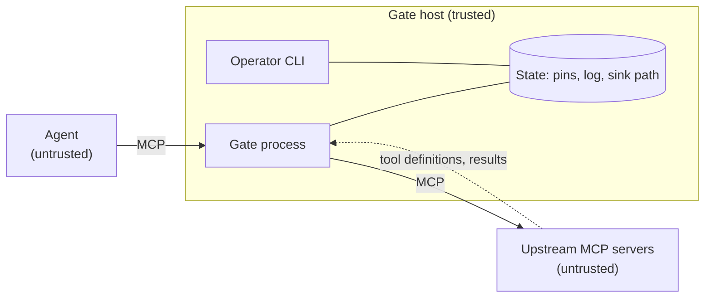

# Threat model: honeycomb-gate (M1)

Status: first version, 24 October 2026, covering what exists after M1 (event log, pinning, policy). It is updated at every milestone. **A community developer is to review this before gate G1**; findings go in section 8. Method: list assets and trust boundaries, then walk each component asking what an attacker could do, what stops them, how we test it and what remains.

## 1. Scope

In scope: the gate process, its config and state files (`pins.json`, the event log, the second sink), its CLI, and the link between agent, gate and upstream servers.

Out of scope for M1: the host operating system, the agent's own model, network enforcement (M3), decoys and honeytokens (M2), run tokens (M3), approvals (M4). Where a control belongs to a later milestone, the table says so, so nobody assumes it exists.

## 2. Assets

| Asset | Why it matters |
| --- | --- |
| Data and actions reachable through upstream tools | What a hijacked agent would steal or damage |
| Pinned tool definitions (`pins.json`) | Decide which tool definitions the gate trusts |
| Policy file | Decides allow and deny |
| Event log and second sink | Evidence; the basis of incidents |
| Operator approvals | Turn a quarantined tool back on |

## 3. Trust boundaries

The agent, the upstream servers and everything they send (descriptions, results, errors) are untrusted. The gate host, the operator and the policy file are trusted. Without network enforcement (M3) nothing stops the agent from bypassing the gate: the product treats that as enforcement level L0 or L1 ([ADR-0004](adr/0004-enforcement-levels.md)).

## 4. Adversaries

1. A malicious or compromised upstream MCP server (poisoned descriptions, rug pulls, shadowing, hostile results).
2. Indirect prompt injection steering the agent through documents, pages or tool output.
3. A compromised or runaway agent.
4. A local attacker or insider with some access to the gate host.
5. An attacker attacking the gate itself: flooding, malformed input, log tampering.

## 5. Threats and controls

Status: **Done** (built and tested in M1), **Later** (planned milestone), **Accepted** (residual risk we are choosing to carry).

| # | Threat | Control | Status | Test | Residual risk |
| --- | --- | --- | --- | --- | --- |
| T1 | Upstream changes a tool definition after trust is established (rug pull) | Per-tool SHA-256 over everything the agent sees (name, title, description, input and output schemas, annotations, execution hints); any change quarantines the tool; the operator must approve the exact pending hash after viewing a diff (`tools show`, `tools approve --hash`). A definition swapped right after an approval is quarantined too | Done | `test_scenario_s2`, `test_registry` | The default re-checks the live definition on every call (`recheck_ttl_s: 0`), at the cost of one extra upstream round trip. Raising it creates a window in which a changed tool is still trusted; a demo with a 2 s window let a poisoned tool through, which is why 0 is the default |
| T2 | Poisoned description from first sight (trust on first use) | Instruction-like text anywhere in a definition (description, title, schema fields) is flagged as `tool.suspicious_description`; strict mode requires approval before a tool is visible | Done (flags are signals) | `test_registry` malicious and benign sets | Learning mode pins a poisoned first definition; use strict mode for untrusted upstreams. Heuristics can be evaded |
| T3 | Tool-name shadowing or ambiguous routing across upstreams | Names are namespaced `upstream__tool`; upstream names are limited to lower-case letters, digits and `-`, so routing is unambiguous; pins are per upstream | Done | `test_ambiguous_upstream_names_are_rejected` | None known |
| T4 | Misleading tool annotations ("read only") or hidden metadata | Annotations are never used for any decision (but are pinned, so a change quarantines); `_meta` and icons are not forwarded to the agent | Done | `test_forwarded_tools_carry_no_unpinned_metadata`, `test_hash_covers_everything_the_agent_sees` | None known |
| T5 | Call to an unknown, hidden or quarantined tool by guessing its name | Resolved against live definitions; quarantined or unapproved tools are denied; policy hides denied tools from the list | Done | `test_passthrough`, `test_scenario_s2`, `test_a_definition_swapped_right_after_approval_is_still_caught` | None known |
| T6 | Over-broad or dangerous call (e.g. `exec`, 500 recipients) | First-match policy with tool, upstream and argument matchers. A deny rule treats a missing or wrong-typed argument as a match, so changing an argument's type does not slip past a limit; a rule that errors at runtime fails closed if it is a deny rule; high-impact patterns (`*exec*`, `*shell*`, `*delete*`, `*drop*`, `*truncate*`, `*destroy*`, `*wipe*`, case-insensitive) fail closed on error; `approve` and caps refuse to load until M4 | Done (allow, deny) / Later (approve, caps) | `test_policy` | Until M4 there is no human approval path |
| T7 | Policy typo silently weakens protection | Unknown fields rejected; unsupported features and invalid regular expressions refuse to load; argument matchers must name a tool or upstream; `policy check` command | Done | `test_policy` | A logically wrong rule still loads |
| T8 | Secrets written into logs | Key-based redaction (camelCase, snake_case and compound names such as `accessToken`, `api_key`) and value-based redaction before storage; agent-chosen names (`tool`, `upstream`) are redacted, stripped of control characters and shortened; strings are capped before scanning; digest of the full payload kept | Done | `test_events` (redaction, names), `test_passthrough` | New secret formats can slip through; redaction is best effort. State files are readable only by their owner, and the SQLite index is a convenience copy, not evidence |
| T9 | Attacker edits, deletes or reorders log lines | SHA-256 hash chain; `events verify` | Done | `test_events` | The hash is unkeyed: an attacker who can rewrite the log **and** the second sink can recompute everything (see T10). Backlog E1-6: keyed chain with the key held elsewhere, and a remote sink |
| T10 | Attacker truncates, deletes or replaces the log or the sink | A checkpoint (count and chain head) goes to the second sink after **every** event, plus full copies of high and critical events; the sink file is created at start, so a missing sink or a missing log fails `events verify`; one writer per log (a second gate is refused rather than forking the chain); a torn last line stops the gate instead of continuing a broken chain | Done if the sink is on storage the attacker cannot write | `test_events` | Same-account attackers can still rewrite both files. Later: remote sink |
| T11 | Attacker with write access to `pins.json` re-approves a poisoned tool or forges the recorded approver | Not prevented: state files are trusted (they are created readable only by their owner, and access is serialised with a file lock) | Accepted | n/a | Protect the state directory. Later: sign approvals; take approver identity from the approval broker |
| T12 | Approver identity is only the OS user name | Recorded in `tool.approved` | Accepted | n/a | Weak attribution. Later: approver identity from the approval broker (M4) |
| T13 | Log flooding or oversized input exhausts disk, memory or CPU | Lines capped at 8 KiB (tool and upstream names shortened to 128 characters, strings to 8 KiB before any scan); redaction patterns are bounded and tested for stalling; pagination capped at 100 pages with repeated cursors refused | Partial | `test_events`, `test_gate_robustness` | No rate limit on call volume yet; add in M4 with deduplication |
| T14 | Hostile tool results carry injections or planted secrets | Results are passed through unchanged | Later (M2) | n/a | Honeytoken scan on results arrives in M2; text classification is deliberately not used for decisions ([ADR-0003](adr/0003-data-plane-control-plane-split.md)) |
| T15 | Agent bypasses the gate | Not enforceable by software alone | Later (M3) | n/a | Enforcement levels make this explicit; lab uses an internal network |
| T16 | Stolen or replayed identity | No run tokens yet; one run id per connection | Later (M3) | n/a | See ADR-0002 |
| T17 | Hijacked agent touches a decoy or honeytoken | Not yet built | Later (M2) | n/a | n/a |
| T18 | A denied call leaks policy details to the attacker | Agent sees one generic message; reason is only in the log | Done | `test_passthrough` | The tool list itself reveals what exists |
| T21 | The audit record is lost after the action happened | The decision is logged **before** the call is forwarded; if the log cannot be written, the call does not happen. A second event, `call.completed`, records the outcome | Done | `test_a_call_is_not_forwarded_if_the_decision_cannot_be_logged` | A crash between the two events leaves a decision with no outcome, which is visible |
| T22 | An operator approves a definition they did not review | Approval requires the pending hash and fails if the definition changed since it was shown | Done | `test_approval_needs_the_hash_the_operator_reviewed` | The operator must still read the diff |
| T19 | Upstream crash or error crashes the gate | Errors are logged as `gate.error`; high-impact and strict deployments return a block message | Done | covered in code paths; add fault-injection test in M2 | A crashing upstream still makes its tools fail |
| T20 | Denial of service by many concurrent calls | Not handled | Accepted for M1 | n/a | Needs rate limits (M4) |

## 6. Assumptions

- The gate host is not compromised, and its state directory is writable only by the operator and the gate.
- The operator reviews a changed definition before approving it.
- For protection against bypass, the agent has no network path except through the gate (M3).

## 7. How to keep this current

Add a row for every new attack found by the [threat watch](program/THREAT-WATCH.md), mark it Done only when a test exists, and map each control to the OWASP Top 10 for Agentic Applications (ASI01 to ASI10) when the mapping table is built in M5. Pinning and quarantine relate to tool and supply-chain risks (ASI02 and ASI04); the log relates to rogue-agent evidence (ASI10).

## 8. Review log

| Date | Reviewer | Findings | Status |
| --- | --- | --- | --- |
| 24 Oct 2026 | Author | First draft | Superseded by the next row |
| 24 Oct 2026 | Independent automated review of the M1 code (a separate reviewer with read-only access, findings then reproduced by the author) | 16 findings: 2 high, 10 medium, 4 low. Fixed in the same milestone: post-approval swap, unpinned fields, argument-type bypass of deny rules, bad regex disabling policy, narrow high-impact patterns, redaction stall, camelCase keys, missing-evidence verification, tail truncation, blind approval, forged log lines, ambiguous routing, audit-after-action, pagination loop, locking, file permissions. Overclaims in this document corrected. Residual: unkeyed hash chain (E1-6) | Closed; awaiting community review |
