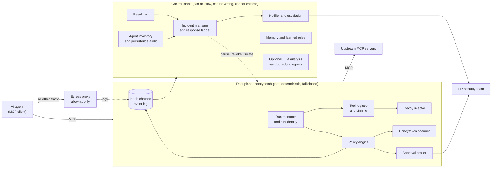

# Architecture review (24 October 2026)

Status: proposal for the owner. Each finding links to a decision record in [docs/adr/](../adr/README.md).

This review checks the Phase 0 design in [PHASE0-SPEC.md](../PHASE0-SPEC.md) and [ARCHITECTURE.md](../ARCHITECTURE.md) against three things: the facts we have now verified, how comparable products work and fail, and the product goal. The goal is a first layer of defence that keeps hostile or runaway AI agents out of an organisation's systems, stops them living there, and tells the IT or security team quickly.

## What we checked

| Question | How we checked | Result |
| --- | --- | --- |
| Does the current MCP spec still have sessions? | Read `docs/specification/2026-07-28/changelog.mdx` in the official `modelcontextprotocol/modelcontextprotocol` repository | **No.** Revision 2026-07-28 removes protocol-level sessions and the `Mcp-Session-Id` header. Servers needing state use explicit handles passed as tool arguments (SEP-2567). Our "session manager" and `session_id` assumptions are out of date. |
| Is there a permissively licensed gateway we could build on? | Cloned and read `IBM/mcp-context-forge` and `lasso-security/mcp-gateway` | ContextForge: Apache-2.0, last commit 23 October 2026, a plugin framework with dozens of plugins. Lasso: MIT, last commit 22 January 2026 (about nine months quiet). |
| Does either implement our differentiators? | Keyword search of those clones for decoy, honeypot, honeytoken, canary, rug-pull and definition-pinning code | None found in either. This is a keyword search of shallow clones, not a full audit. |
| Can we reuse Thinkst Canarytokens code? | Read its `LICENSE` | **No.** GPL v3 with extra clauses that treat integrating, linking to or executing it as a derivative work. We may reuse ideas only. See ADR-0008. |

## Findings and corrections

### Keep (the design is sound here)

- **Gateway between agent and tools, with decoys, honeytokens, pinning, approvals and a lab.** Nothing we found contradicts it, and no surveyed gateway has the decoy or governor features.
- **Default-deny egress at the network, not in a prompt.** Still the strongest single control, and CERT-In's advisory says the same.
- **Python, `uv`, the official SDK.** Fine. The SDK is a new major version (2.x), so we pin it.

### Correct (changes we propose)

| # | Finding | Why it matters | Correction |
| --- | --- | --- | --- |
| 1 | The spec assumes MCP sessions. The 2026-07-28 revision removes them. | Run identity (F7), session pause and the event schema all keyed on sessions. | The gate mints its own `run_id` and signed run token. `session_id` becomes optional. **ADR-0002** |
| 2 | One component list mixes enforcement with analysis, and the plan allows LLMs near the decision path. | An LLM in the enforcement path can be prompt-injected into allowing a call. It also adds latency, which is the top honeypot giveaway. | Split a small, deterministic **data plane** (the gate) from a **control plane** (incidents, baselines, memory, optional LLM analysis). No LLM ever decides allow or deny. **ADR-0003** |
| 3 | The spec says the gate is advisory without network enforcement, but the product never says so to the operator. | An operator could believe they are protected when an agent can simply bypass the gate. | Define enforcement levels and make the gate report its level honestly. **ADR-0004** |
| 4 | Tamper-evident logging is a stretch goal. | An attacker that lives in a system tampers with logs first. Early logs without a hash chain cannot be trusted later. | Hash-chain the event log from M1 and add a separate alert sink. **ADR-0005** |
| 5 | The design covers an agent doing a bad thing now. It does not cover agents that **get in and stay**: unknown agents, long-lived runs, planted MCP config, scheduled tasks, poisoned memory, new credentials. | This is the goal in the owner's brief ("prevent agents from being in the system continuously and living there"). It is also the CERT-In finding: agents inside, undetected. | Add an agent inventory, run lifetime limits and a persistence and memory audit. **ADR-0006** |
| 6 | Alerts (F11) are a JSON message. There is no incident, no acknowledgement and no escalation. | A critical alert nobody sees at 3 AM is no defence. The response needs a defined ladder and a record of what the gate already did. | Add an incident object, a response ladder with autonomy limits, and notification with escalation. **ADR-0007** |
| 7 | We planned to study Canarytokens and "reuse formats where the licence allows". | Its licence does not allow it for our Apache-2.0 code. | Clean-room token formats and a licence rule. **ADR-0008** |
| 8 | D1 (own proxy or build on a gateway) was open. | Needed to plan. | Own thin core now, with a plugin seam so a ContextForge plugin can be packaged later. **ADR-0001** |

### Watch (risks, no change yet)

- **Convergence.** ContextForge ships weekly and has a plugin system. If it adds decoys and pinning, our unique features shrink. Mitigation: ADR-0001's plugin seam and the threat watch in [THREAT-WATCH.md](THREAT-WATCH.md).
- **Specification churn.** A new revision removed sessions three months before we started. We pin versions and run a contract test against each new revision.
- **Scope.** Ten agent roles, a mesh and a signalling bus are the long-term picture. Phase 0 builds the gate and its control plane only.

## Resulting architecture (Phase 0)

The only control-plane to data-plane path is a short list of fixed commands (pause run, revoke identity, quarantine tool, isolate agent). It can restrict the gate, never relax a policy.

## Open questions for the owner

1. Approve or change ADR-0001 to ADR-0008 (each has a status line).
2. Approve the autonomy limits in ADR-0007: decoy and honeytoken trips may pause a run and revoke its identity automatically. Anything beyond that needs a human.
3. Which agent clients should we support first (D2)? The plan assumes any standard MCP client over stdio and Streamable HTTP, with a generic Python client in the lab as the first test target.
